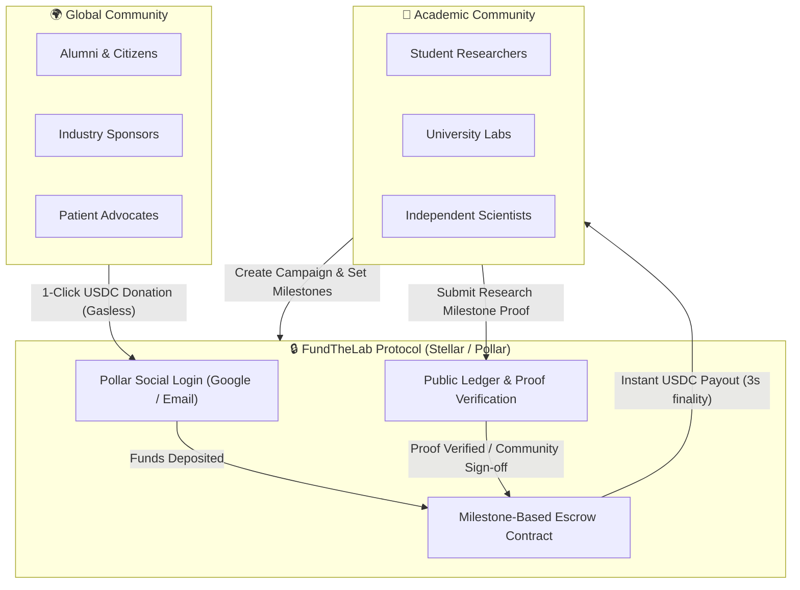

# FundTheLab: Decentralized Micro-Grant & Open Research Platform
**Bridging Academic Research & Global Philanthropy via Stellar & Pollar**

---

## 1. Executive Summary

**FundTheLab** is a Decentralized Science (DeSci) crowdfunding and milestone-based escrow platform designed to connect university labs, student researchers, and independent scientific initiatives directly with global donors, alumni, patient advocacy groups, and industry sponsors.

By leveraging **Stellar’s** fast, low-cost payment rails and **Pollar’s** frictionless embedded wallet and gasless onboarding SDK, FundTheLab eliminates the high bureaucratic overhead, multi-month delays, and geographic lock-ins of traditional academic grants. Anyone in the world can fund scientific research with a single click using a familiar social login (Google/Email), while researchers receive predictable USDC micro-grants upon verifiable progress.

---

## 2. Background: From Web1 to Web3

To understand why Web3 is essential for this problem, we look at the evolution of the web:

```
┌─────────────────────────┐     ┌─────────────────────────┐     ┌─────────────────────────┐
│          Web1           │     │          Web2           │     │          Web3           │
│      (1990s - 2004)     │ ──> │      (2004 - Present)   │ ──> │      (Next Era)         │
│         "READ"          │     │     "READ + WRITE"      │     │    "READ+WRITE+OWN"     │
│   Static HTML pages,    │     │   Centralized platforms │     │  Decentralized networks │
│   informational web     │     │   (GoFundMe, Kickstarter)│    │  (Self-custody, USDC)   │
└─────────────────────────┘     └─────────────────────────┘     └─────────────────────────┘
```

* **Web1 (Read)**: Decentralized and open, but static. Information was consumed, not created collaboratively.
* **Web2 (Read + Write)**: Empowered mass participation through platforms like Kickstarter, GoFundMe, and Patreon. However, centralized intermediaries control the financial rails, charge 5%–10% in platform and credit card fees, impose restrictive geographic barriers, and hold custody over all capital.
* **Web3 (Read + Write + Own)**: Driven by blockchains, open protocols, and self-sovereign cryptographic accounts. Value moves peer-to-peer across borders in seconds with zero gatekeepers, unbribable automated escrow rules, and full public verifiability.

---

## 3. Core Blockchain Building Blocks

| Primitive | Definition | Role in FundTheLab |
| :--- | :--- | :--- |
| **Distributed Ledger** | A shared, tamper-proof record of transactions maintained across independent nodes globally. | Provides an immutable public audit trail for every dollar donated, locked, and disbursed. |
| **Smart Contracts** | Deterministic programs on a blockchain executing logic automatically when pre-defined conditions are met. | Acts as an unbiased **Milestone Escrow**. Funds remain protected until research milestones are verified. |
| **Stablecoins (USDC)** | Cryptographic tokens backed 1:1 with real US Dollar reserves, avoiding market volatility. | Protects research budgets from price fluctuations. \$1.00 contributed is \$1.00 spent on lab equipment. |
| **Embedded Wallets** | Cryptographic keypairs managed seamlessly behind familiar Web2 authentication (Passkeys, Google, Email). | Removes the friction of seed phrases and browser extensions, enabling mainstream donors and researchers to participate. |

---

## 4. The Problem: The Broken Academic Funding Pipeline

Scientific innovation is currently bottlenecked by an outdated grant distribution system:

1. **Extreme Bureaucracy**: Principal investigators and PhD students spend up to **40% of their research time** writing and formatting grant proposals for federal agencies (NIH, NSF, ERC).
2. **The "Valley of Death" for Micro-Grants**: Grant committees prioritize large, multi-million-dollar multi-year programs. Small grants between **\$500 and \$5,000**—the exact amounts junior researchers need for lab reagents, open-access compute, or survey incentives—are neglected.
3. **University Overhead Skimming**: When a researcher wins an external grant, university administration routinely cuts **30% to 50%** in "indirect costs" before the lab receives funds.
4. **Paywalled Science**: Research funded by the public often ends up trapped behind corporate journal paywalls charging \$35+ per paper, slowing global collaboration.
5. **Cross-Border Restrictions**: International researchers and labs in emerging economies struggle to access global research capital due to banking and currency barriers.

---

## 5. The Solution: DeSci Powered by FundTheLab

**FundTheLab** introduces a transparent, milestone-driven crowdfunding paradigm:



### Key Value Pillars
* **Direct-to-Researcher Funding**: Eliminates university overhead skims; 100% of donor funding goes directly to scientific work.
* **Accountability Through Milestones**: Donated funds are not handed out in a lump sum. They are locked in escrow and released proportionally as the lab hits verifiable milestones (e.g., *Milestone 1: Protocol design, Milestone 2: Data collection, Milestone 3: Open-source paper release*).
* **Open Science Incentives**: Unlocking late-stage milestones can be tied to publishing open datasets or preprints, ensuring science remains accessible to the public.

---

## 6. Technology Architecture

### Why Stellar?
* **Sub-Second Finality**: Stellar confirms transactions in 3–5 seconds, offering immediate feedback to donors and recipients.
* **Ultra-Low Cost**: Network fees are a fraction of a cent ($< \$0.0001$), making \$5 and \$10 micro-donations viable without fee erosion.
* **Native Asset Architecture**: Built-in support for regulated stablecoins like USDC with compliance trustlines.

### Why Pollar?
Pollar solves the primary usability failure point of Web3:
* **Embedded Social Wallets**: Donors sign in using their Google account or email. Pollar provisions a Stellar account in the background—no seed phrases required.
* **Fee Sponsorship**: Pollar sponsors transaction gas fees, eliminating the need for users to acquire and hold native XLM tokens.
* **Payment Runner (`runTx`)**: Ready-made modal dialogs allow donors to sign USDC transfers directly in the web app.

---

## 7. Hackathon MVP Scope

For the hackathon submission on **Pollar**, the MVP focuses on a crisp, demonstrable end-to-end flow:

1. **Campaign Discovery Page**: Browse open research initiatives across fields (AI alignment, environmental science, bio-medicine).
2. **Project Detail & Milestone Tracker**: Clear visual representation of project goals, target budgets, and milestone progress bars.
3. **Pollar Integration**:
   * One-click "Connect with Google" authentication via Pollar SDK.
   * "Donate USDC" modal executing gasless transactions to the project escrow.
4. **Researcher Portal**:
   * Create a new research project with defined milestone allocations.
   * Submit milestone completion updates (e.g., links to IPFS datasets, GitHub repositories, or preprint links).

---

## 8. Summary

FundTheLab turns academic research funding from an opaque, bureaucratic struggle into an open, community-powered engine. By combining Stellar's financial speed with Pollar's seamless onboarding, the project demonstrates how Web3 technology can solve tangible, real-world problems in the scientific and university ecosystem.
